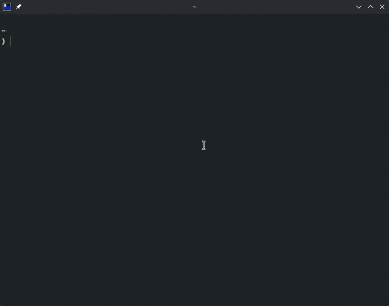

# ac

`ac` is a command line utlity to help with the download of GarageBand and Logic Pro audio content files.



# Motivation

With `ac` you can easily manage Apple audio content across a fleet of Macs. Allowing you to easily download audio content to meet the needs of a given system or fleet. With ac you can get just the content you need and build repeatable deployments utilizing MDM or shell scripts! 

# Installation

Download the available binaries from the [releases]('github.com/w0/ac/releases'). If you don't see a build for your system. Try using the `go install` option.

## Install via `go install`

`go install github.com/w0/ac@latest`

# Usage

View available commands and built in help

`ac -h`

All commands require access to the bundled audio content plist. You can typically find this inside of the app bundle for GarageBand or Logic Pro. Specify it with the `-p` flag.

`ac <command> -p /Path/To/Audio/Content/Plist`


## list

You can use ac to list out available pkg files that are mandatory or optional. This is pretty verbose and is best parse with utilities like grep or awk.

If you don't specify a filter flag all pkgs will be printed. You can also filter

```bash
ac list -p /path/to/plist.plist -m # List only the mandatory pkg files
ac list -p /path/to/plist.plist -o # List only the optional pkg files
```

ac is also able to print the filtered pkg info in the json format

`ac list -p /path/to/plist.plist -m -j`

## download

You can use the same filtering flags with list when downloading audio content pkgs.

Download a single pkg by name and save it to the desktop.

```bash
ac download -p /path/to/plist.plist -d ~/Desktop -n "GarageBand11BaseContentPackage"`
ac download -p /path/to/plist.plist -d ~/Desktop -i "com.apple.pkg.MAContent10_GarageBand6Legacy"
```

Download multiple pkgs and save them to the current working directory.

`ac download -p /path/to/plist.plist -n "GarageBand11BaseContentPackage" -n "GarageBand11ExtraContentPackage"`

## install

ac can attempt to install the downloaded content packages for you. You must run `ac` as root for this.

```bash
ac install -p /path/to/plist.plist -m
```

# 🤝 Contributing

### Clone the repo

```bash
git clone https://github.com/w0/ac.git
cd ac
```

### Build a release

```bash
go build
```

### Run tests

```bash
go test ./audiocontent
```

### Submit a pull request

If you'd like to contribute, please fork the repository and open a pull request.
